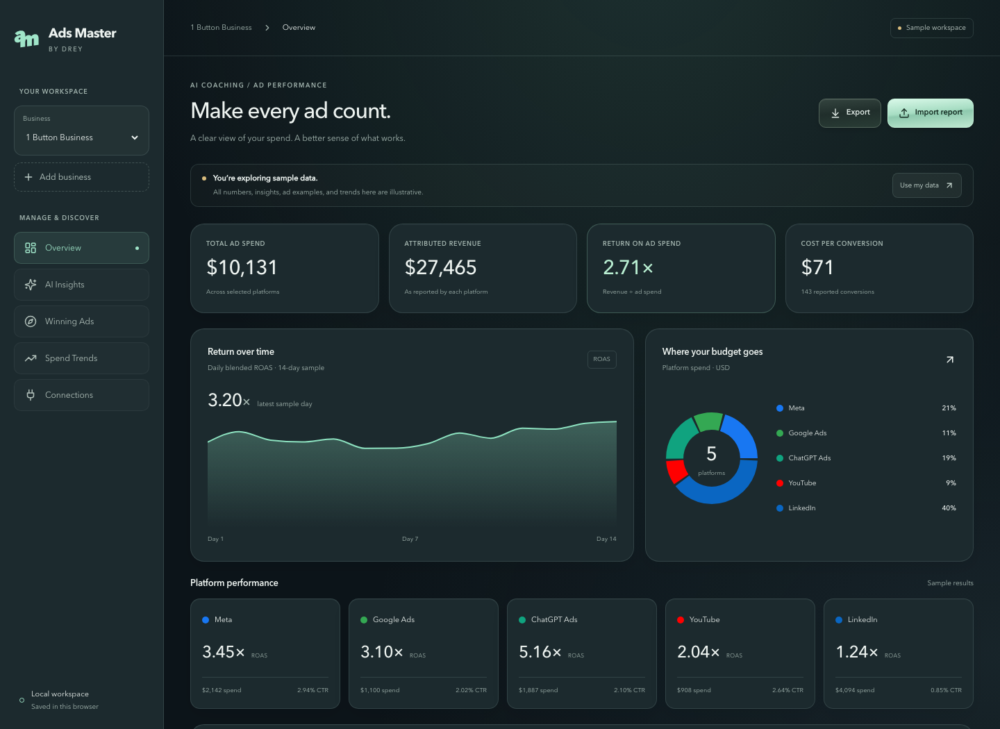

# Ads Master

Drey's advertising workspace, with a smoked-glass theme, private ChatGPT, Meta and Google Ads reporting, business switching, and browser-local CSV import/export.

## Use the app

```bash
npm ci
npm run dev -- --port 3210
```

Open http://localhost:3210. Keep using the same hostname to retain browser-local CSV imports. Node.js 22+ is recommended.

1. Select a business or choose **Add business**.
2. Choose **Import report** and download the CSV template.
3. Fill one or more rows using the columns below, then choose the reporting period and import.
4. Review measured spend, attributed revenue, return on ad spend (ROAS), and cost per conversion. Use **Export** to keep a backup.

```csv
platform,spend,revenue,impressions,clicks,conversions
meta,100,400,10000,200,10
openai,50,300,2000,100,5
```

The example above is fictional. Supported platform IDs: `meta`, `google`, `tiktok`, `linkedin`, `openai`, `youtube`. Amounts are USD; counts must be whole numbers. Duplicate platform rows are aggregated. Every import replaces the previous report for that business. Use matching reporting periods and attribution definitions; summed platform-attributed revenue can count the same purchase more than once.

Imported reports and custom businesses are saved in this browser's local storage. Export reports before clearing browser data. CSVs stay in the browser; imports do not transmit them to Vercel, Convex, or an AI provider. Imported platform reports do not supply daily trends, individual creatives, AI recommendations, or pipeline events. Missing information stays empty. Sample mode is explicitly labeled throughout.

## Private account reports

The personal workspace offers Google sign-in through Convex Auth. Only the verified Google email configured as `AUTH_OWNER_EMAIL` can sign in. The server independently checks the authenticated owner before reading the account API. Registration alone cannot grant access.

The OpenAI, Meta and Google Ads connectors read delivery for the last 30 completed days in America/New_York, in USD. Each validates the account ID, currency and timezone, follows pagination, and rejects incomplete/invalid results. The selected platform fetches on opening the reporting view and every five minutes while visible; returning after five minutes refreshes it. There is no background scheduler when the view is closed. Results stay in memory and clear on sign-out. No public cache or localStorage contains connected reports.

This connection covers **spend, impressions and clicks** only. Revenue and conversions are not fetched, and ad revenue is not cash available for personal purchases. TikTok and LinkedIn await provider setup. Meta uses GET; Google uses its read-only Search RPC via POST and service-account OAuth; there are no campaign-write or budget-change endpoints. The OpenAI key has broader management permissions; Meta has ads_read and Google has account-level Read only access. All credentials remain server-only. Google access tokens renew on demand. Meta user tokens expire and require reconnection; no perpetual-login guarantee is made.

### Configuration

Vercel production variables: `NEXT_PUBLIC_CONVEX_URL`, `NEXT_PUBLIC_CONVEX_SITE_URL`, `OPENAI_ADS_API_KEY` (Sensitive), `OPENAI_ADS_ACCOUNT_ID`. The Ads key is an **Advertiser API key**, not an OpenAI model key or conversion key. Never prefix it with `NEXT_PUBLIC_`.

Additional Vercel variables: `META_ADS_ACCESS_TOKEN` (Sensitive), `META_ADS_ACCOUNT_ID` (`act_...`), `GOOGLE_ADS_SERVICE_ACCOUNT_JSON` (Sensitive JSON), `GOOGLE_ADS_CUSTOMER_ID` (10 digits). Meta API v26.0 and Google Ads v25 are pinned to verified working endpoints. Enable Google Ads API and obtain Explorer access in Google Cloud; give the service account **Read only** access directly to the advertiser account. No Google Cloud project roles or manager linkage are needed. Store credentials using `vercel env add` with stdin, never commit them.

Convex variables: `SITE_URL`, `AUTH_OWNER_EMAIL`, `AUTH_GOOGLE_ID`, `AUTH_GOOGLE_SECRET`, `JWT_PRIVATE_KEY`, `JWKS`. Use separate auth signing keys for development and production. Google OAuth callbacks are `https://<deployment>.convex.site/api/auth/callback/google`; configure each approved deployment explicitly in Google Cloud. Keep Google identity scopes to openid, email and profile.

Run `npx convex dev --once` for the development backend and `npx convex deploy` for production. `convex.json` deploys **only `backend/`**, containing authentication and the owner query. It does not deploy the original `convex/` scaffold. App builds work without provider configuration and fail closed for account reporting. Backend code changes must be deployed separately from the Vercel frontend.

Before calling a connection live, verify a real Google sign-in, authenticated reporting, unauthenticated denial, wrong-user denial, and sign-out in the hosted app. The in-app update archive is `/updates`.

## Current boundaries

The original `convex/` backend and provider adapters remain **unfinished, disabled integration scaffolding**. Do not deploy them or enter credentials there. `lib/live.ts` deliberately keeps this legacy path off, even when the separate authentication backend is configured. This version does not change budgets or publish ads.

`app/api/insights` is disabled with HTTP 410 and makes no AI requests. The named ads and consumer trends in sample mode are illustrative placeholders, not verified current research.

## Development and checks

```bash
npm run typecheck
npm run check:ui
npm run build
npx playwright install chromium
npm run test:ui
```

Browser tests run against the production build, so run `npm run build` first. Playwright covers report validation/aggregation, persistence, business isolation, download, errors, keyboard dialog behavior, responsive overflow at 320/390/720px, reduced motion, and axe accessibility scans. The UI gate rejects browser alerts, raw exception display, and arbitrary Tailwind text sizes. GitHub Actions runs these checks when this branch is pushed.

- [Architecture diagram (editable Mermaid)](docs/diagrams/workspace.mmd)
- [Rendered architecture diagram](docs/diagrams/workspace.svg)
- [Local UI standard](docs/UI-STANDARD.md)
- [Engineering changelog](CHANGELOG.md)
- [Original architecture](docs/ARCHITECTURE.md) and [roadmap](docs/ROADMAP.md) describe the original wider plan, not verified live integrations.

Source structure: `components/Dashboard.tsx` owns workspace selection; `Overview.tsx` presents results; `ImportReport.tsx` validates and previews CSVs through `lib/reports.ts`; `GlassDialog.tsx` uses the browser's native accessible modal behavior; `app/globals.css` owns shared glass, metal, motion, and responsive styles.

## Preview



[Mobile screenshot](docs/screenshots/mobile.png)

## Hosted workspace

- App: https://adsmaster.dreythomas.com
- Drey personal workspace: https://adsmaster.dreythomas.com/drey (starts empty)

Both links use the same app and browser-local storage for CSV imports. The personal link selects Drey's Personal Ads and offers a private connected reporting view. Imported CSVs are not protected by account login: anyone using the same browser profile can view them. Connected data requires the approved login and is fetched through Vercel. Reports imported on localhost must be exported and imported on the hosted domain.

Updates pushed or merged into `main` deploy automatically through the Vercel GitHub integration. Feature branches receive preview deployments. Open or refresh the app after a deployment to load the latest version; active forms are not force-reloaded. CI checks run on pushes and pull requests.

Deployment uses Vercel project `ads-master` in scope `dreys-projects-277f634a`. Link explicitly with `vercel link --yes --project ads-master --scope dreys-projects-277f634a`, run the checks above, then deploy with `vercel deploy --prod --scope dreys-projects-277f634a`. Private reporting requires the provider configuration above. Cloudflare manages the `adsmaster` DNS record; do not change the apex or other subdomains.

This is a personal reporting tool, not a customer account service. A future plugin could give the approved owner a read-only delivery summary and link to `/drey`. That workflow would need authenticated MCP tools with the same owner and account checks; a skill alone cannot access private live reports. CSV validation is a separate possible skill and must not upload browser-local reports without consent. Start with one reporting tool, measure successful report reads and app opens, and budget support for expired sessions or account keys. Plugin packaging is deferred until hosted authentication and reporting are verified. No plugin has been submitted or published.

The previous `ads.dreythomas.com` address remains available for exporting reports saved on that origin. Browser storage is separate for each hostname; import the exported CSV on the new address.

### Glass Workspace

The approved visual direction is recorded in [THEME-DECISION.md](THEME-DECISION.md). Open the personal workspace and choose **Account reports** in the navigation for private reporting. The glass design adapts to mobile and respects reduced motion and reduced transparency.

The **DreyOS Growth** sidebar shortcut opens the separately authenticated Growth workbook. Select 1BB there for its connected ChatGPT Ads, Stripe and PostHog reports. This is navigation, not a report-data bridge: DreyOS totals do not populate Ads Master's sample/CSV charts. See the [reporting architecture](docs/diagrams/reporting.mmd). Hourly refresh is installed and verified in DreyOS for 1BB's three providers and personal Stripe plus ChatGPT Ads; Ads Master's Meta and Google reports still refresh only while open.
